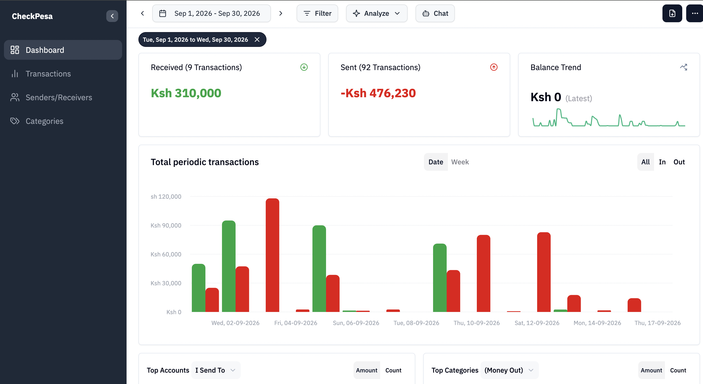
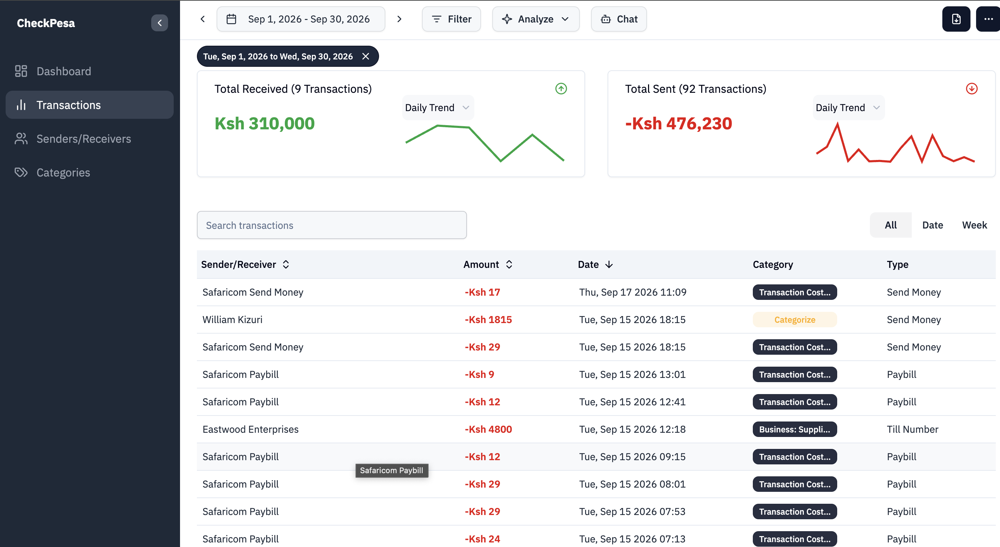
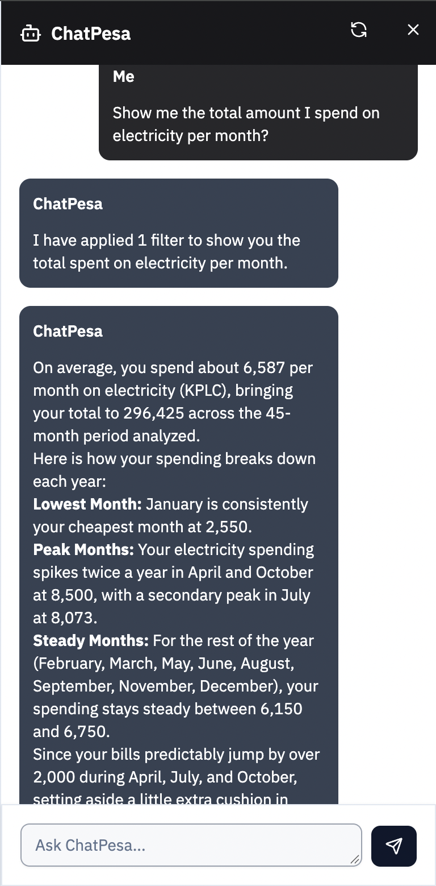

# CheckPesa - M-Pesa Transaction Analytics Platform

CheckPesa is a financial analytics platform designed specifically for M-Pesa users in Kenya. This application allows users to easily upload their M-Pesa statements, categorize transactions, and gain valuable insights into their financial behavior through interactive visualizations and AI-powered analysis.

## Table of Contents

- [Features](#features)
- [Tech Stack](#tech-stack)
- [Getting Started](#getting-started)
  - [Prerequisites](#prerequisites)
  - [Backend Setup](#backend-setup)
  - [Frontend Setup](#frontend-setup)
- [Usage Guide](#usage-guide)
- [Project Structure](#project-structure)

<!--
Screenshots: add images to a docs/ folder (all with fake data only), then remove this comment wrapper.

## Screenshots




-->

## Features

### Core Functionality

- **M-Pesa Statement Import**: Upload M-Pesa PDF statements with automated transaction parsing
- **Transaction Management**: View, search, filter, and categorize transactions
- **Financial Dashboard**: Visual overview of income, expenses, balance trends, and transaction patterns

### Analytics & Visualizations

- **Multi-dimensional Analysis**: Analyze spending by period, category, or recipient
- **Interactive Charts**: Visualize financial data through various chart types (bar, line, pie)
- **Temporal Analysis**: Group transactions by hour, day, week, month, or year
- **Top Lists**: View top senders, receivers, categories, and transaction patterns

### AI-Powered Insights (Google Gemini)

- **Financial Assessment**: Generate AI analysis of spending patterns and financial health
- **Personalized Recommendations**: Get tailored financial advice based on transaction history
- **ChatPesa**: A conversational assistant that lets you ask questions about your finances in natural language and get AI-generated insights into your spending
- **Multiple Analysis Modes**: Choose between "Serious Mode" for professional insights or "Roast Mode" for humorous financial feedback

### User Experience

- **Responsive Design**: Fully responsive interface that works on desktop and mobile devices
- **Offline Capability**: Local database storage for secure offline access
- **Privacy-Focused**: All data is stored locally in the browser (IndexedDB)

## Tech Stack

### Frontend
- **Framework**: React with TypeScript
- **UI Components**: ShadCN UI components with Tailwind CSS
- **Visualizations**: Recharts
- **Local Database**: Dexie.js (IndexedDB wrapper)

### Backend
- **Framework**: Flask (Python)
- **PDF Processing**: PyMuPDF
- **API**: RESTful endpoint for sending pdf for processing

### AI
- **Model provider**: Google Gemini API

## Getting Started

### Prerequisites

- Node.js (v18+)
- Python (3.9+)
- pip (Python package manager)
- A Google Gemini API key for the AI features (free from [Google AI Studio](https://aistudio.google.com))

### Backend Setup

1. Set up a Python virtual environment:
   ```bash
   cd backend
   python -m venv venv

   # On Windows
   venv\Scripts\activate

   # On macOS/Linux
   source venv/bin/activate
   ```

2. Install backend dependencies:
   ```bash
   pip install -r requirements.txt
   ```

3. Run the Flask server:
   ```bash
   python app.py
   ```

   The backend API will be available at http://localhost:8000

### Frontend Setup

1. Navigate to the frontend directory:
   ```bash
   cd frontend
   ```

2. Install frontend dependencies:
   ```bash
   npm install --legacy-peer-deps
   ```

3. Add your Gemini API key. Copy the example environment file and put your own key in it:
   ```bash
   cp .env.example .env
   ```
   Then open `.env` and set:
   ```
   VITE_GEMINI_API_KEY=your_key_here
   ```
   The `.env` file is ignored by Git, so your key is never uploaded. Never commit a real key.

4. Start the development server:
   ```bash
   npm run dev
   ```

   The frontend application will be available at http://localhost:5173

## Usage Guide

### Loading Data

1. To use your own data, click the "Upload Button" on the top-right of the screen, select your M-Pesa PDF statement and enter the statement's password
2. The system will automatically parse and load your transactions
3. Alternatively, you can click on the 'generate fake data' button at the top right to explore the app with sample data

### Categorizing Transactions

1. Navigate to the Transactions page
2. Click on the category badge of any transaction
3. Select or create a category and subcategory
4. Optionally choose to apply the same category to similar transactions

### Analyzing Your Finances

1. Use the Dashboard to get a high-level overview of your financial status
2. Navigate to Categories to see spending breakdowns by category
3. Visit the Accounts page to analyze transactions by sender/receiver
4. Use the date range filter to focus on specific time periods
5. Try the AI Analysis feature or chat with ChatPesa for personalized financial insights

## Project Structure

### Frontend

```
frontend/
├── public/           # Static assets
├── src/
│   ├── components/   # UI components
│   ├── database/     # IndexedDB storage logic
│   ├── hooks/        # Custom React hooks
│   ├── lib/          # Utility functions
│   ├── pages/        # Page components
│   ├── stores/       # Zustand state management
│   ├── types/        # TypeScript type definitions
│   ├── App.tsx       # Main application component
│   └── main.tsx      # Application entry point
└── package.json      # Project dependencies
```

### Backend

```
backend/
├── utils/            # Utility functions
│   ├── parser.py     # PDF parsing logic
│   ├── transactions_extractor.py  # Transaction extraction
│   └── metadata_extractor.py      # Transaction metadata
├── app.py            # Flask application
├── config.py         # Configuration settings
└── requirements.txt  # Python dependencies
```